<div align="center">

# 🛰️ RSICD-Captioner

### Describing satellite and aerial imagery in plain English

Four CNN → LSTM / Transformer captioning models, built from scratch in PyTorch,<br>
trained on the RSICD remote-sensing dataset, compared head to head, and probed with seven ablations.

<p>
  <a href="https://www.python.org/"></a>
  <a href="https://pytorch.org/"></a>
  <a href="https://www.kaggle.com/datasets/thedevastator/rsicd-image-caption-dataset"></a>
  
  <a href="LICENSE"></a>
</p>

[**Results**](#-results) · [**Gallery**](#-what-the-models-see) · [**Architecture**](#-architecture) · [**Ablations**](#-seven-ablations) · [**Quick start**](#-quick-start) · [**Notebook**](notebooks/main-notebook.ipynb)

</div>

<br>

<table align="center">
  <tr>
    <td width="25%">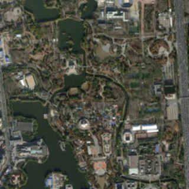</td>
    <td width="25%">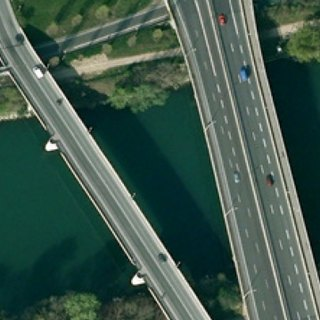</td>
    <td width="25%">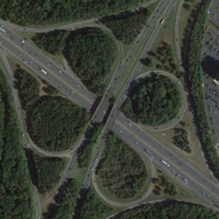</td>
    <td width="25%">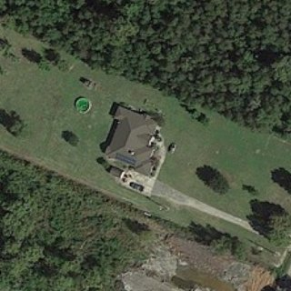</td>
  </tr>
  <tr>
    <td><sub><i>“many green trees and a pond are around a park with many buildings .”</i></sub></td>
    <td><sub><i>“a bridge is on a river with some green trees on two sides of it .”</i></sub></td>
    <td><sub><i>“many green trees are close to a viaduct .”</i></sub></td>
    <td><sub><i>“many green trees are around a building with a swimming pool .”</i></sub></td>
  </tr>
</table>

<p align="center"><sub>Captions written by <b>MobileNet-v2 + Transformer</b> for validation images it never trained on — verbatim from the recorded run.</sub></p>

<table align="center">
  <tr>
    <th>4</th><th>7</th><th>15–30×</th><th>~41 min</th>
  </tr>
  <tr>
    <td align="center"><sub>encoder × decoder models</sub></td>
    <td align="center"><sub>ablation experiments</sub></td>
    <td align="center"><sub>higher BLEU-4, LSTM → Transformer</sub></td>
    <td align="center"><sub>to train all four on one P100</sub></td>
  </tr>
</table>

## ✨ Highlights

- 🧱 **Built from scratch** — tokenizer, lazy-loading dataset, both encoders, both decoders, mixed-precision training loop, BLEU/METEOR scoring and Grad-CAM are all written directly against PyTorch. No captioning framework.
- ⚔️ **Four architectures, one protocol** — ResNet-18 or MobileNet-v2 encoders × LSTM or Transformer decoders, same data, same 5-epoch budget.
- 🏆 **The decoder decides quality** — swapping the LSTM for a Transformer raises BLEU-4 15–30×; swapping the encoder moves it by less than 0.01.
- 🔬 **Seven ablations** — backbone cost, rotation invariance, vision–text interfaces, memory tokens, dropout placement and a decoding length penalty, each with an honest verdict.
- 🔥 **Explainability** — Grad-CAM heatmaps traced from a predicted word back into the CNN.
- 📓 **Fully recorded** — the original notebook ships with every log and figure intact, and every number in this README lives in [`results/metrics.json`](results/metrics.json).

## 🏆 Results

> Trained for 5 epochs on a single Tesla P100 (16 GB) · fp16 mixed precision · effective batch 512 · metrics on an 800-caption validation subset.

| Model | Params | Best val loss ↓ | BLEU-4 ↑ | METEOR ↑ | Repetition ↓ | Inference ↓ |
|:--|--:|--:|--:|--:|--:|--:|
| ResNet-18 + LSTM | 15.9 M | 3.246 | 0.003 | 0.217 | 60.1 % | 24 ms |
| MobileNet-v2 + LSTM | **7.4 M** | 3.237 | 0.006 | 0.204 | 17.8 % | **23 ms** |
| ResNet-18 + Transformer | 30.6 M | 2.027 | 0.078 | **0.400** | **0.4 %** | 73 ms |
| MobileNet-v2 + Transformer | 22.1 M | **1.949** | **0.083** | 0.391 | 24.4 % | 85 ms |

<sub>BLEU-4 is sentence-level and unsmoothed, each caption scored against one reference. Repetition is the share of captions containing 3+ identical consecutive words. Inference is greedy captioning of one 16-image batch (Experiment 1).</sub>

<picture>
  <source media="(prefers-color-scheme: dark)" srcset="assets/charts/caption-quality-dark.svg">
  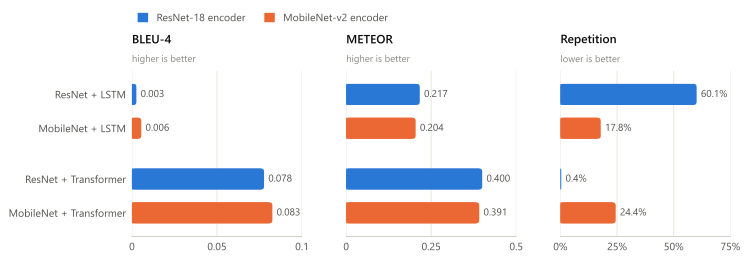
</picture>

### What the numbers say

**1 · The decoder dominates, not the encoder.** Swapping ResNet-18 for the ~4× smaller MobileNet-v2 changes BLEU-4 by less than 0.01 within either decoder family. Swapping the LSTM for the Transformer multiplies it 15–30×. On RSICD the bottleneck is how the caption is generated, not how the image is seen.

**2 · The LSTMs fall into degenerate repetition.** ResNet+LSTM produces a run of 3+ identical words in 60% of its captions (`"many pieces of of of land are are ."`). Repetitive output rarely shares a 4-gram with the reference, so unsmoothed BLEU-4 collapses to ~0, while METEOR, which credits individual matching words, still gives it 0.22.

**3 · The Transformer mostly fixes it.** Causal self-attention conditions on the whole prefix instead of a single hidden vector, and ResNet+Transformer repeats in just 0.4% of captions. Not every Transformer gets there, though: MobileNet+Transformer still repeats in 24.4%, despite having the best validation loss and BLEU-4.

**4 · MobileNet is the efficient choice, not a free lunch.** MobileNet+Transformer has the best validation loss (1.949) and BLEU-4 (0.083) with 8.5 M fewer parameters than ResNet+Transformer, but trails it on METEOR (0.391 vs 0.400) and repetition (24.4% vs 0.4%).

### Training curves

<picture>
  <source media="(prefers-color-scheme: dark)" srcset="assets/charts/training-curves-dark.svg">
  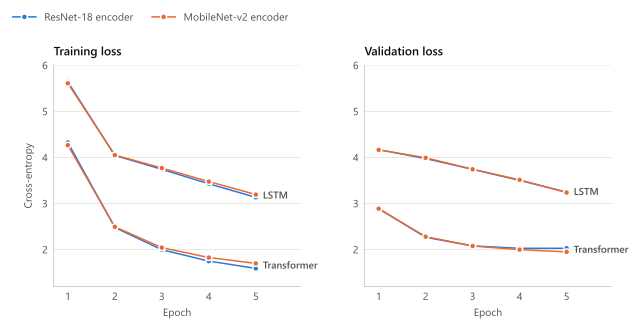
</picture>

The LSTMs are still improving in lockstep on train and validation at epoch 5 (3.13 / 3.25 for ResNet), so they are underfit rather than overfit, and more epochs would likely help. ResNet+Transformer's validation loss flattens after epoch 4 (2.0274 → 2.0276) while its training loss keeps falling, which is the first sign of overfitting. All four models trained back to back in **~41 minutes**.

### Same image, four models

An external demo image (not from RSICD), captioned by every model:

```text
ResNet-18    + LSTM          many buildings are are in a of a .
MobileNet-v2 + LSTM          many buildings are in a a .
ResNet-18    + Transformer   many cars are in a large building .
MobileNet-v2 + Transformer   many buildings are around a large playground .
```

## 👀 What the models see

### Rotation invariance

Overhead imagery has no canonical "up": the same scene on another orbit pass is the same scene rotated. Here is one validation image per model, captioned at four angles:

<table>
  <tr>
    <th></th><th>0°</th><th>90°</th><th>180°</th><th>270°</th>
  </tr>
  <tr>
    <th rowspan="2">MobileNet<br>+&nbsp;Transformer</th>
    <td></td>
    <td></td>
    <td></td>
    <td></td>
  </tr>
  <tr>
    <td colspan="4" align="center"><sub><i>“a bridge is on a river with some green trees on two sides of it .”</i> — identical at all four angles</sub></td>
  </tr>
  <tr>
    <th rowspan="2">ResNet<br>+&nbsp;LSTM</th>
    <td>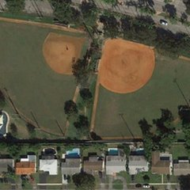</td>
    <td>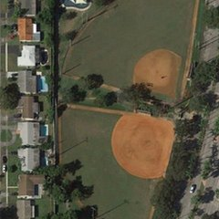</td>
    <td>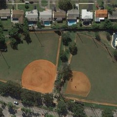</td>
    <td>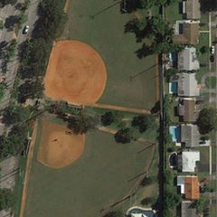</td>
  </tr>
  <tr>
    <td><sub><i>a green trees are in a green trees and a .</i></sub></td>
    <td><sub><i>a playground is is a is with a green trees and a .</i></sub></td>
    <td><sub><i>a playground is is a by green trees and a green trees .</i></sub></td>
    <td><sub><i>a playground is is a is by a green trees and a .</i></sub></td>
  </tr>
</table>

Scored over six diverse validation scenes as the mean Jaccard overlap of each rotated caption's word set with the 0° caption, the LSTM is actually *more* consistent (0.788 vs 0.749). It is consistently generic, though, so the score partly reflects insensitivity to the image rather than robustness. In the recorded run each model also drew its own six scenes, so the comparison is loose. See [Experiment 2](#-seven-ablations).

### Grad-CAM: where the encoder looks

Grad-CAM weights the last convolutional feature maps $`A^k`$ by how strongly they push up the logit $`y_w`$ of the first predicted word:

```math
\alpha_k = \frac{1}{HW}\sum_{i,j}\frac{\partial y_w}{\partial A^k_{ij}}, \qquad
L_{\text{Grad-CAM}} = \mathrm{ReLU}\Big(\sum_k \alpha_k A^k\Big)
```

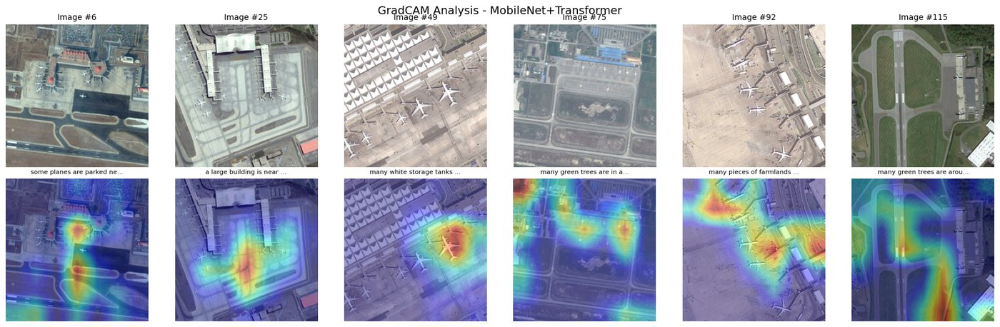

<details>
<summary><b>Grad-CAM for the other three models</b></summary>

<br>

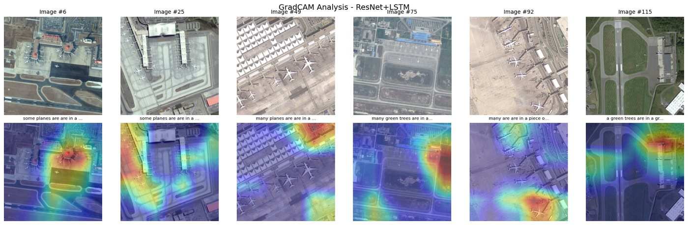
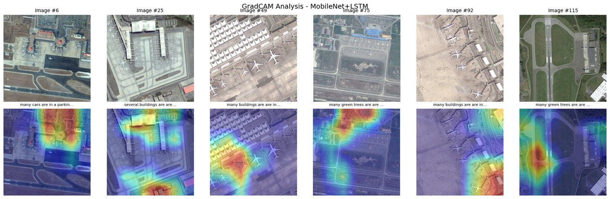
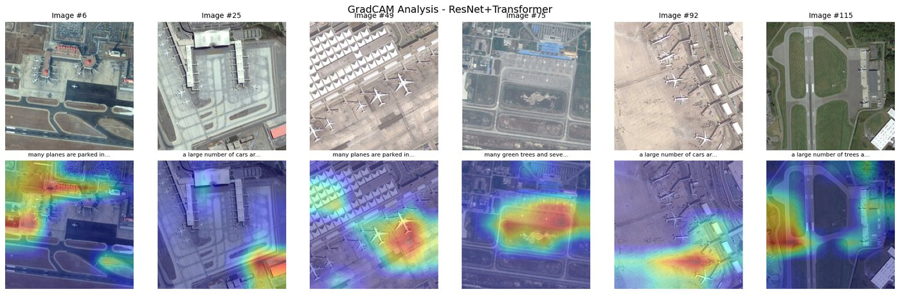

</details>

## 🧩 Architecture

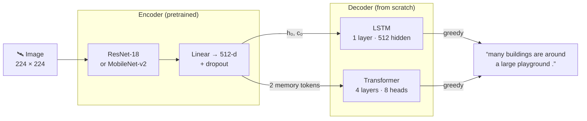

| | LSTM decoder | Transformer decoder |
|:--|:--|:--|
| **Image enters as** | linear projections into the initial hidden *and* cell state | 2 memory vectors (linear + LayerNorm) for cross-attention |
| **Size** | 1 layer · 512 hidden | 4 layers · 8 heads · d<sub>model</sub> 512 · FF 2048 |
| **Words** | 512-d learned embeddings | 512-d learned embeddings + sinusoidal positions |
| **Dropout** | 0.2 | 0.1 |
| **Parameters** | 4.47 M | 19.19 M |
| **Learning rate** | 1e-4, ×0.7 after epoch 3 | 5e-5, ×0.7 after epoch 3 |

Both families share the same training recipe: Adam, cross-entropy with teacher forcing (`<pad>` ignored), batch 256 × 2 gradient-accumulation steps, fp16 autocast with `GradScaler`, 5 epochs. The encoders add 11.44 M (ResNet-18) or 2.88 M (MobileNet-v2) parameters, including their 512-d projection.

## 🔬 Seven ablations

<details>
<summary><b>1 · Backbone comparison</b> — MobileNet-v2 costs almost nothing in quality</summary>

<br>

Same decoders, different encoder, measured on identical batches (500 validation captions, unsmoothed BLEU-4).

| Model | Inference / 16 images | BLEU-4 | METEOR |
|:--|--:|--:|--:|
| ResNet-18 + LSTM | 23.8 ms | 0.0036 | 0.2232 |
| MobileNet-v2 + LSTM | 22.6 ms | 0.0060 | 0.2135 |
| ResNet-18 + Transformer | 72.7 ms | 0.0671 | 0.3922 |
| MobileNet-v2 + Transformer | 85.5 ms | 0.0677 | 0.3843 |

Within each decoder family the two encoders land within 0.01 on both metrics. The real cost is on the decoder side: the Transformer is ~3× slower, being a 4× larger decoder that re-runs the whole prefix at every step, while the LSTM carries its state forward. MobileNet+Transformer is even slower than ResNet+Transformer despite its lighter encoder. The LSTM pair, with the same two encoders, differs by only ~1 ms, so that gap comes from the decoding loop, consistent with MobileNet+Transformer also writing the longest captions (13.0 words on average).

</details>

<details>
<summary><b>2 · Rotation invariance</b> — both keep ~¾ of their words across rotations</summary>

<br>

Each image is captioned at 0°/90°/180°/270° and scored by the mean Jaccard overlap of each rotated caption's word set with the 0° caption. Scenes are sampled across land-use keywords, because naive sampling returns airport after airport.

| Model | Consistency (6 scenes) |
|:--|--:|
| ResNet-18 + LSTM | 0.788 |
| MobileNet-v2 + Transformer | 0.749 |

The LSTM scores *higher*, but its captions are generic and repetitive enough to be stable regardless of input (see the [strips above](#rotation-invariance)), so a high score here partly reflects insensitivity rather than robustness. The two scores also come from different images: the recorded run seeded the scene sampler once, so each model drew its own six scenes. The package re-seeds per model, so a re-run scores both on the same scenes.

</details>

<details>
<summary><b>3 · Vision–text interface, trained models</b> — LSTM BLEU-4 is exactly zero</summary>

<br>

Unsmoothed BLEU-4 on a fixed 50-sample slice:

| Model | BLEU-4 |
|:--|--:|
| ResNet-18 + LSTM | 0.0000 |
| MobileNet-v2 + LSTM | 0.0000 |
| ResNet-18 + Transformer | 0.0431 |
| MobileNet-v2 + Transformer | 0.0588 |

Exact zeros for both LSTMs: without smoothing, a caption with no matching 4-gram scores exactly 0, and repetitive LSTM output rarely contains one.

</details>

> [!CAUTION]
> **Experiments 4–6 come with a caveat.** In each, both variants wrap *one shared* ResNet-18 instance (in the notebook and in the package). It is trainable and the variants are trained one after the other, so the second variant starts from an encoder the first has already fine-tuned on the same subset. In all three experiments the second-trained variant ends with the lower training loss, which that head start alone could explain. Treat these differences as unresolved.

<details>
<summary><b>4 · LSTM interface: init-hidden vs image-as-token</b> — a tie</summary>

<br>

Two ways to feed the image into an LSTM: project it into the initial hidden state, or prepend it as a pseudo-word. Each variant is a new small model (a pretrained ResNet-18 trunk plus a fresh decoder), trained for 3 epochs on 500 training captions.

| Variant | Train loss | Val loss | Train-loss drop, epochs 1→3 |
|:--|--:|--:|--:|
| Init-hidden | 1.128 | **2.636** | 2.065 |
| Image token *(trained second)* | **1.115** | 2.660 | 2.177 |

0.02 apart on validation: a tie. The main models use init-hidden, since it costs one fewer timestep.

</details>

<details>
<summary><b>5 · Transformer memory tokens: 1 vs 4</b> — 4 tokens look more overfit, but see the caveat</summary>

<br>

How many vectors should the image expand into for cross-attention? 3 epochs on 300 training captions.

| Variant | Train loss | Val loss |
|:--|--:|--:|
| 1 token | 1.039 | **3.000** |
| 4 tokens *(trained second)* | **0.969** | 3.075 |

The 4-token variant fits the training set better and generalises worse, which is the classic overfitting signature. It was also trained second on the shared encoder, though, and that head start produces the same pattern on its own. The main models use 2 tokens.

</details>

<details>
<summary><b>6 · Dropout placement</b> — within noise</summary>

<br>

Same rate (0.3), two positions. 3 epochs on 400 training captions.

| Placement | Train loss | Val loss | Train − val gap |
|:--|--:|--:|--:|
| On embeddings | 1.170 | 2.770 | −1.600 |
| In the decoder block *(trained second)* | **1.111** | **2.759** | −1.648 |

The two placements are within noise of each other, so neither is decisive at this scale.

</details>

<details>
<summary><b>7 · Length penalty during greedy decoding</b> — ⚠ inconclusive: the penalty never ran</summary>

<br>

Greedy decoding tends to stop early because `<eos>` is a high-frequency token. The idea is to damp the `<eos>` logit at decoding steps $`t > 5`$, $`\ell_{\text{eos}} \leftarrow \ell_{\text{eos}} - 0.1\,\lambda\,(t-5)`$, and sweep $`\lambda \in \{0, 0.5, 1, 2\}`$.

| Model | BLEU-4 (smoothed) | Avg length |
|:--|--:|--:|
| ResNet-18 + LSTM | 0.1997 | 9.4 |
| MobileNet-v2 + LSTM | 0.1783 | 8.9 |
| ResNet-18 + Transformer | 0.2478 | 11.3 |
| MobileNet-v2 + Transformer | 0.2544 | 11.6 |

> [!WARNING]
> **These rows are plain greedy decoding, identical for every λ.** The recorded run's penalised decoder passed the one-token prefix `[<bos>]` to the model's teacher-forcing `forward`, which drops the last position. The decoder therefore received an empty sequence and raised on the very first step, and an `except` silently fell back to ordinary greedy decoding. The package version is fixed and verified (at λ = 0 it now matches each model's own greedy output token for token). Re-run `python scripts/run_experiments.py --experiments length_penalty` for real numbers.

BLEU-4 here is smoothed, so it is not comparable with the unsmoothed numbers elsewhere.

</details>

## 📚 Dataset

[RSICD](https://arxiv.org/abs/1712.07835): 10,921 overhead images, each with five human-written captions, distributed here in its [Kaggle CSV form](https://www.kaggle.com/datasets/thedevastator/rsicd-image-caption-dataset) with the JPEG bytes stored inline.

| Split | Images | Captions | Vocab coverage | OOV | Avg length |
|:--|--:|--:|--:|--:|--:|
| Train | 8,734 | 41,518 | 99.80 % | 0.20 % | 12.0 words |
| Validation | 1,094 | 5,069 | 98.82 % | 1.18 % | 10.2 words |
| Test | 1,093 | 5,129 | 98.17 % | 1.83 % | 12.5 words |

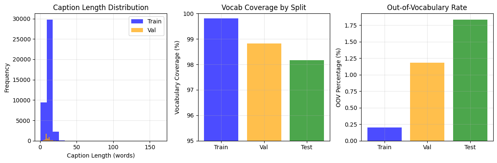

The vocabulary is built from **training captions only**, capped at 10k words with `min_word_freq = 2`. That leaves just **1,803 tokens**, including the four specials `<pad> <bos> <eos> <unk>`, because RSICD's caption language is far narrower than the cap. Coverage above 98% on unseen splits means out-of-vocabulary words are not what limits caption quality here.

## 🚀 Quick start

**Requirements:** Python 3.10+, the RSICD CSVs, and ideally a CUDA GPU. Training all four models took ~41 minutes on a P100, which is impractical on CPU.

```bash
git clone https://github.com/nadeemshabir/Image-captioning.git
cd Image-captioning

python -m venv .venv
source .venv/bin/activate          # Windows: .venv\Scripts\activate
pip install -r requirements.txt    # or, as a package: pip install -e ".[notebook]"
```

If the default PyTorch wheel doesn't match your CUDA driver, install PyTorch for your setup from [pytorch.org](https://pytorch.org/get-started/locally/) before the requirements.

Download [the dataset](https://www.kaggle.com/datasets/thedevastator/rsicd-image-caption-dataset) and place the three CSVs in `data/`:

```text
data/
├── train.csv     # columns: filename · captions · image (raw JPEG bytes, inline)
├── valid.csv
└── test.csv
```

### Pipeline

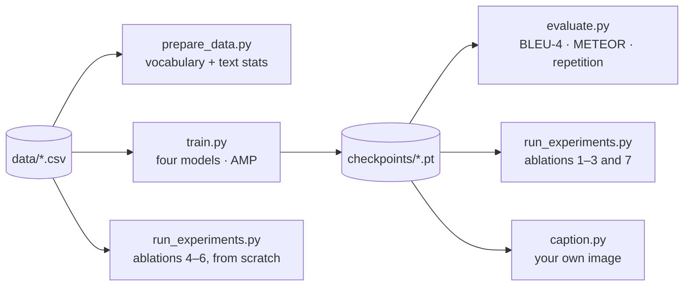

```bash
# 1 · vocabulary + train/val/test text statistics          → results/text_stats.csv
python scripts/prepare_data.py --data-root data

# 2 · train all four models                                → checkpoints/*.pt, results/training_history.json
python scripts/train.py --data-root data --epochs 5
python scripts/train.py --data-root data --models ResNet+Transformer --batch-size 128   # just one

# 3 · BLEU-4, METEOR, length, repetition (+ best/worst captions) → results/evaluation.json
python scripts/evaluate.py --data-root data --qualitative

# 4 · ablations (4–6 train their own small models, no checkpoints needed) → results/experiments.json
python scripts/run_experiments.py --data-root data --experiments all
python scripts/run_experiments.py --data-root data --experiments memory_tokens dropout

# 5 · caption your own image with every trained model
python scripts/caption.py path/to/scene.jpg --data-root data
```

Every script takes `--help`. Experiment names for `--experiments` are `backbones`, `rotation`, `interface`, `lstm_interface`, `memory_tokens`, `dropout`, `length_penalty` and `all`.

### From Python

```python
import torch
from PIL import Image

from rsicd_captioner.config import MODEL_VARIANTS, Config
from rsicd_captioner.data import CaptionTokenizer, ImagePreprocessor, extract_all_captions, load_splits
from rsicd_captioner.models import build_model

config = Config()
config.model.pretrained = False                      # weights come from the checkpoint

# The vocabulary isn't stored in the checkpoint: rebuild it from the training captions.
train_df, _, _ = load_splits(config.data)
tokenizer = CaptionTokenizer()
tokenizer.build_vocabulary(extract_all_captions(train_df))

model = build_model(len(tokenizer), *MODEL_VARIANTS["MobileNet+Transformer"], config.model)
state = torch.load("checkpoints/mobilenet_transformer.pt", map_location="cpu")
model.load_state_dict(state["model_state_dict"])

pixels = ImagePreprocessor().preprocess_image(Image.open("scene.jpg"))
batch = torch.from_numpy(pixels).permute(2, 0, 1).unsqueeze(0).float()
print(model.generate_caption(batch, tokenizer)[0])
```

> [!TIP]
> [`notebooks/main-notebook.ipynb`](notebooks/main-notebook.ipynb) is the original end-to-end run, with every log and figure intact (~19 MB). If GitHub's preview won't load it, open it on [nbviewer](https://nbviewer.org/github/nadeemshabir/Image-captioning/blob/main/notebooks/main-notebook.ipynb). It reads the dataset from Kaggle's `/kaggle/input/` mount, so it is meant to be run on Kaggle with the RSICD dataset attached.

## 📁 Project structure

```text
.
├── rsicd_captioner/                 the importable package
│   ├── config.py                    one dataclass config for every tunable
│   ├── data/                        tokenizer · preprocessing · lazy Dataset · text statistics
│   ├── models/                      CNN encoder · LSTM and Transformer decoders · model factory
│   ├── training/                    AMP + gradient-accumulation loops · memory helpers
│   ├── evaluation/                  BLEU-4 / METEOR / repetition · qualitative · error slices
│   ├── experiments/                 one module per ablation
│   └── explain/gradcam.py           Grad-CAM for captioning models
├── scripts/                         CLI entry points (prepare_data · train · evaluate · run_experiments · caption)
├── notebooks/main-notebook.ipynb    the original Kaggle run, outputs intact
├── results/metrics.json             every number reported in this README
├── assets/                          README charts, sample tiles and figures
├── pyproject.toml · requirements.txt · LICENSE
└── data/ · checkpoints/             created locally, git-ignored
```

The package is the notebook's pipeline refactored into importable modules. It builds the same four models (parameter counts match the notebook to the digit) and scores with the same metric definitions.

## 🧠 Implementation notes

Three things that were not obvious going in, and that shaped the code:

**Lazy image decoding is not optional.** Decoding all ~10.9k images up front costs about 6 GB, and since every image appears once per caption, the naive version stores each image five times over. `RSICDDataset` keeps only row indices and pre-tokenised captions (tens of MB) and decodes JPEGs in `__getitem__`. This also keeps DataLoader workers cheap, since each would otherwise inherit a copy.

**Mixed precision needs a dtype contract.** On GPU the dataset emits fp16 tensors to halve PCIe traffic, and training runs under `autocast`. Generation runs *outside* autocast, though, so the inference paths explicitly cast both model and inputs to fp32. Otherwise the first matmul raises on a dtype mismatch.

**BLEU and METEOR are strict about input shape.** Both NLTK functions want lists of word strings: never index tensors, never a joined sentence. Passing a string makes NLTK iterate over characters and return a meaningless number instead of raising, so `evaluation/metrics.py` centralises the conversion.

## 🚧 Limitations and known issues

**Limitations**

- BLEU-4 is low in absolute terms. Five epochs over a 1.8k-word vocabulary is a baseline, not a tuned result. Longer training, beam search, and spatial attention over feature maps (instead of a single pooled vector) are the obvious next steps.
- Metrics come from validation subsets, not the held-out test split, and each caption is scored against one reference even though RSICD provides five. Scoring against all five would raise every BLEU number here.
- The Transformer re-runs the full prefix at every decoding step; caching keys and values would remove most of its inference cost.

**Known issues, found while auditing the recorded run**

- **Experiment 7 never applied its penalty**, so its flat sweep is an artifact (details in [Experiment 7](#-seven-ablations)). Fixed in the package.
- **Experiments 4–6 share one trainable encoder** between the two variants (see the caution above them). The package keeps this design, to stay faithful to the recorded run.
- **Batched greedy decoding keeps generating until every caption in the batch has emitted `<eos>`**, and `decode_caption` drops `<eos>` without truncating at it. Words a caption produces after its own `<eos>` therefore stay in it during batched evaluation, and the recorded metrics include this effect. Single-image captioning (`caption.py`) is unaffected.
- **Captions containing an apostrophe are mis-parsed.** The CSV stores those captions in double quotes, and `parse_caption_list` reads single-quoted strings, so a caption like *"there's a house in the middle."* becomes `s a house in the middle."` and the image's remaining captions are dropped. The notebook has the same behaviour, so the recorded vocabulary and caption counts include it.

## 🙏 Acknowledgements

- **RSICD** — X. Lu, B. Wang, X. Zheng and X. Li, *Exploring Models and Data for Remote Sensing Image Caption Generation*, IEEE TGRS 56(4), 2018 ([arXiv:1712.07835](https://arxiv.org/abs/1712.07835)), via the [Kaggle mirror](https://www.kaggle.com/datasets/thedevastator/rsicd-image-caption-dataset).
- **Grad-CAM** — R. R. Selvaraju et al., *Grad-CAM: Visual Explanations from Deep Networks via Gradient-based Localization*, ICCV 2017 ([arXiv:1610.02391](https://arxiv.org/abs/1610.02391)).
- ImageNet-pretrained backbones from [torchvision](https://pytorch.org/vision/stable/models.html), and BLEU/METEOR from [NLTK](https://www.nltk.org/).

<details>
<summary>BibTeX for RSICD</summary>

```bibtex
@article{lu2018exploring,
  title   = {Exploring Models and Data for Remote Sensing Image Caption Generation},
  author  = {Lu, Xiaoqiang and Wang, Binqiang and Zheng, Xiangtao and Li, Xuelong},
  journal = {IEEE Transactions on Geoscience and Remote Sensing},
  volume  = {56},
  number  = {4},
  pages   = {2183--2195},
  year    = {2018}
}
```

</details>

## 📄 License

[MIT](LICENSE) © 2025 Nadeem Shabir Mir
